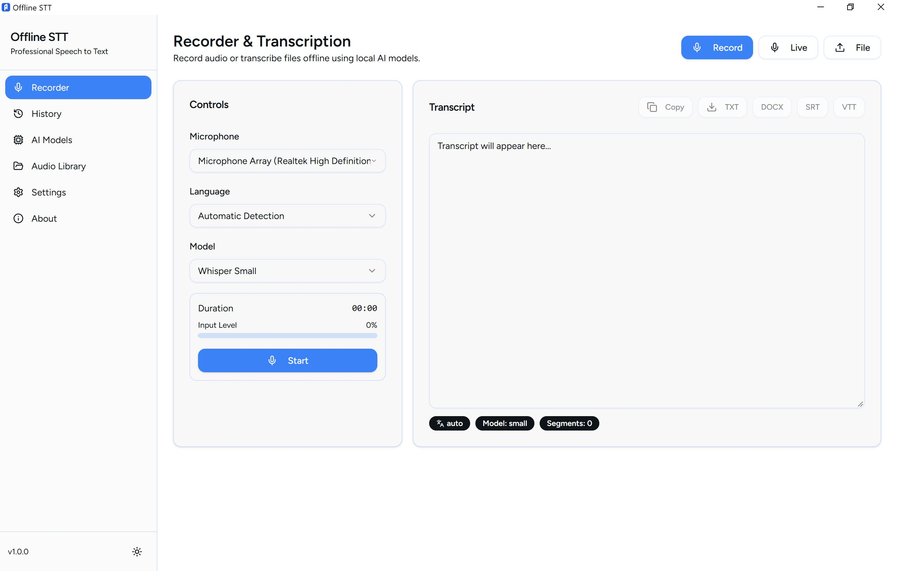
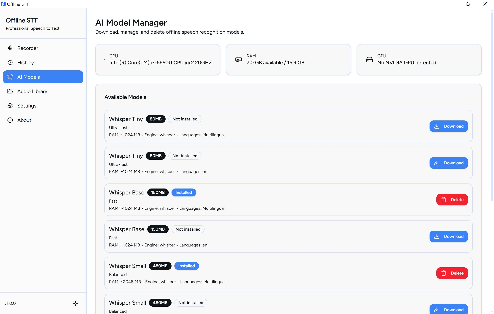

# Offline STT / تبدیل گفتار به متن آفلاین

A professional offline speech-to-text desktop application built on top of [tmoroney/auto-subs](https://github.com/tmoroney/auto-subs), redesigned as a dedicated STT product.

یک اپلیکیشن دسکتاپ حرفه‌ای برای تبدیل گفتار به متن به‌صورت آفلاین، توسعه‌یافته بر پایه مخزن [tmoroney/auto-subs](https://github.com/tmoroney/auto-subs).

---

## English

### Overview
Offline STT is a Windows desktop application for recording audio and transcribing speech to text using local AI models. The application is designed to work offline for transcription and model inference.

### Download
- **Windows Installer**: [Offline-STT_1.0.0_x64-setup.exe](https://github.com/saadath/AutoSubs_Sodian/releases/download/v1.0.0/Offline-STT_1.0.0_x64-setup.exe)

### Key Features
- **Audio Recording**: Select microphone, start/pause/resume/stop recording, live input level, WAV (PCM16) recording.
- **File Transcription**: Transcribe existing audio/video files through the local transcription pipeline.
- **Live Transcription (MVP)**: Basic chunked near-real-time transcription mode (record/transcribe/append).
- **Local AI Inference**: Uses local Whisper/transcribe-rs engines from the existing AutoSubs transcription engine.
- **Model Manager**: View installed/available models, download models, real-time download progress (bytes, percent, speed, ETA), cancel download, delete models.
- **Language Support**: Automatic detection, Persian (Farsi), and English selection in UI; multilingual Whisper models supported by backend.
- **Transcription History**: SQLite-backed history with name, date, duration, language, model, mode, transcript, and audio path.
- **Transcript Editor**: Edit transcript text, copy, save changes.
- **Exports**: TXT, DOCX, SRT, VTT.
- **Audio Library**: View audio-linked records and delete records/audio.
- **Hardware Detection**: CPU/RAM/GPU best-effort detection.
- **Privacy**: No cloud transcription, no automatic upload of recordings/transcripts, local inference.

### Tech Stack
- **Desktop**: Tauri 2
- **Frontend**: React + TypeScript + Tailwind CSS + shadcn/ui
- **Backend**: Rust
- **Audio Capture**: CPAL
- **WAV Writing**: hound
- **Audio Processing**: FFmpeg
- **Speech Recognition**: whisper-rs / transcribe-rs (existing AutoSubs transcription engine)
- **Database**: SQLite (rusqlite)
- **Async**: Tokio

<p align="center">
  
</p>
<hr>
<p align="center">
  
</p>
<hr>

### Project Structure
```text
AutoSubs-App/
  src/                      # React frontend
    pages/                  # STT pages (Recorder, History, Models, Audio Library, Settings, About)
    stt/                    # STT frontend API/types
    components/ui/          # UI components
  src-tauri/
    src/
      main.rs               # Tauri app bootstrap and command registration
      db.rs                 # SQLite history database
      recording.rs          # Microphone recording commands
      stt_export.rs         # TXT/DOCX/SRT/VTT export
      hardware.rs           # Hardware detection
      transcription_api.rs  # Transcription commands
      models.rs             # Model list/delete commands
    crates/
      transcription-engine/ # Whisper/transcribe-rs engine and model manager
  tauri.conf.json           # Tauri config
```

### Development Setup (Windows)
#### Prerequisites
- Node.js LTS
- Rust (rustup, stable MSVC toolchain)
- Visual Studio Build Tools (C++ workload)
- LLVM (for libclang/bindgen)
- WebView2 Runtime (usually installed on Windows 10/11)

#### Run in Dev Mode
```powershell
cd AutoSubs-App
npm install
npm run dev:win
```

If you need to set environment manually:
```powershell
$vcvars='C:\Program Files (x86)\Microsoft Visual Studio\2022\BuildTools\VC\Auxiliary\Build\vcvars64.bat'
$env:Path=[System.Environment]::GetEnvironmentVariable('Path','Machine')+';'+[System.Environment]::GetEnvironmentVariable('Path','User')+';'+$env:USERPROFILE+'\.cargo\bin'
$env:LIBCLANG_PATH='C:\Program Files\LLVM\bin'
cmd /c "`"$vcvars`" >nul && cd /d <repo>\AutoSubs-App && npm.cmd run dev:win"
```

### Build Windows Installer
```powershell
cd AutoSubs-App
npm run build:win
```
Output is generated under `AutoSubs-App/src-tauri/target/release/bundle/nsis/`.

### Usage
1. Open the app.
2. Go to **AI Models** and download a multilingual Whisper model (e.g., `small`, `medium`, or `large-v3-turbo`).
3. Go to **Recorder**.
4. Select microphone and language (Auto/Persian/English).
5. Record audio or select an audio/video file.
6. Review/edit transcript and export to TXT/DOCX/SRT/VTT.
7. Previous transcriptions are available in **History**.

### Known Limitations / MVP Notes
- Live transcription is currently a basic chunked MVP (not full low-latency streaming with overlap/dedup merge).
- Model manager has real download progress/cancel; pause/resume and full checksum catalog UI need completion.
- Persian/English language support is present in transcription/model choices; full Persian RTL UI/localization is still in progress.
- Build was validated in a development environment; additional QA/testing is recommended before production distribution.
- Windows Vulkan feature was disabled in the Windows preset to simplify build setup; GPU behavior may vary by system.

### Security & Privacy
- Transcription runs locally.
- No cloud transcription API keys required for local models.
- Network is used for model downloads from configured sources.
- Avoid committing secrets/tokens into the repository.

---

## فارسی

### معرفی
Offline STT یک اپلیکیشن دسکتاپ ویندوز برای ضبط صدا و تبدیل گفتار به متن با مدل‌های هوش مصنوعی محلی است. هدف این پروژه، ارائه یک تجربه آفلاین برای تبدیل گفتار به متن است.

### دانلود
- **نصب‌کننده ویندوز**: [Offline-STT_1.0.0_x64-setup.exe](https://github.com/saadath/AutoSubs_Sodian/releases/download/v1.0.0/Offline-STT_1.0.0_x64-setup.exe)

### قابلیت‌های اصلی
- **ضبط صدا**: انتخاب میکروفون، شروع/توقف موقت/ادامه/توقف ضبط، نمایش سطح ورودی صدا، ذخیره WAV (PCM16).
- **تبدیل فایل صوتی/ویدیویی به متن**: پردازش فایل‌های موجود با موتور رونویسی محلی.
- **رونویسی زنده (MVP)**: حالت ساده نزدیک به بلادرنگ با پردازش chunkهای چندثانیه‌ای.
- **اجرای محلی AI**: استفاده از موتورهای محلی Whisper/transcribe-rs موجود در AutoSubs.
- **مدیریت مدل‌ها**: مشاهده مدل‌ها، دانلود، نمایش پیشرفت واقعی دانلود (بایت، درصد، سرعت، ETA)، لغو دانلود، حذف مدل.
- **پشتیبانی زبان**: تشخیص خودکار، انتخاب فارسی و انگلیسی در UI؛ پشتیبانی مدل‌های چندزبانه Whisper.
- **تاریخچه رونویسی**: ذخیره در SQLite شامل نام، تاریخ، مدت، زبان، مدل، حالت، متن و مسیر فایل صوتی.
- **ویرایشگر متن**: ویرایش متن رونویسی، کپی و ذخیره.
- **خروجی**: TXT، DOCX، SRT، VTT.
- **کتابخانه صوتی**: مشاهده رکوردهای دارای فایل صوتی و حذف رکورد/فایل.
- **تشخیص سخت‌افزار**: تشخیص CPU/RAM/GPU به‌صورت best-effort.
- **حریم خصوصی**: بدون رونویسی ابری، بدون آپلود خودکار فایل/متن، پردازش محلی.

### تکنولوژی‌ها
- **Desktop**: Tauri 2
- **Frontend**: React + TypeScript + Tailwind CSS + shadcn/ui
- **Backend**: Rust
- **Audio Capture**: CPAL
- **WAV**: hound
- **Audio Processing**: FFmpeg
- **Speech Recognition**: whisper-rs / transcribe-rs
- **Database**: SQLite (rusqlite)
- **Async**: Tokio

### راه‌اندازی توسعه (ویندوز)
#### پیش‌نیازها
- Node.js LTS
- Rust (rustup، ابزار stable-x86_64-pc-windows-msvc)
- Visual Studio Build Tools (بار کاری C++)
- LLVM (برای libclang/bindgen)
- WebView2 Runtime

#### اجرا در حالت توسعه
```powershell
cd AutoSubs-App
npm install
npm run dev:win
```

### ساخت نصب‌کننده ویندوز
```powershell
cd AutoSubs-App
npm run build:win
```
خروجی در مسیر `AutoSubs-App/src-tauri/target/release/bundle/nsis/` ساخته می‌شود.

### نحوه استفاده
1. برنامه را اجرا کنید.
2. به بخش **AI Models** بروید و یک مدل چندزبانه Whisper دانلود کنید (مثل `small`، `medium` یا `large-v3-turbo`).
3. به بخش **Recorder** بروید.
4. میکروفون و زبان (Auto/Persian/English) را انتخاب کنید.
5. ضبط کنید یا فایل صوتی/ویدیویی انتخاب کنید.
6. متن را بررسی/ویرایش و در قالب TXT/DOCX/SRT/VTT خروجی بگیرید.
7. رونویسی‌های قبلی در **History** در دسترس هستند.

### محدودیت‌ها / وضعیت MVP
- رونویسی زنده فعلاً به‌صورت ساده chunk-based است و نیاز به بهبود ادغام/جلوگیری از تکرار دارد.
- مدیریت مدل‌ها پیشرفت واقعی دانلود و لغو را دارد؛ Pause/Resume کامل و نمایش checksum کامل نیاز به تکمیل دارد.
- پشتیبانی زبان فارسی/انگلیسی در رونویسی وجود دارد؛ RTL کامل و بومی‌سازی کامل UI فارسی نیاز به تکمیل دارد.
- قبل از انتشار production، تست و QA کامل توصیه می‌شود.

### حریم خصوصی و امنیت
- پردازش رونویسی به‌صورت محلی انجام می‌شود.
- برای مدل‌های محلی به API key ابری نیاز نیست.
- دسترسی شبکه فقط برای دانلود مدل‌ها (و موارد صریحاً درخواست‌شده) باید استفاده شود.
- توکن‌ها/secretها نباید در مخزن commit شوند.

---

## Credits / قدردانی
- Original project: [tmoroney/auto-subs](https://github.com/tmoroney/auto-subs)
- Whisper/transcription ecosystem and open-source libraries used by the project.

## License
Follow the upstream project licensing and third-party dependency licenses. Review `LICENSE` and dependency licenses before redistribution.
